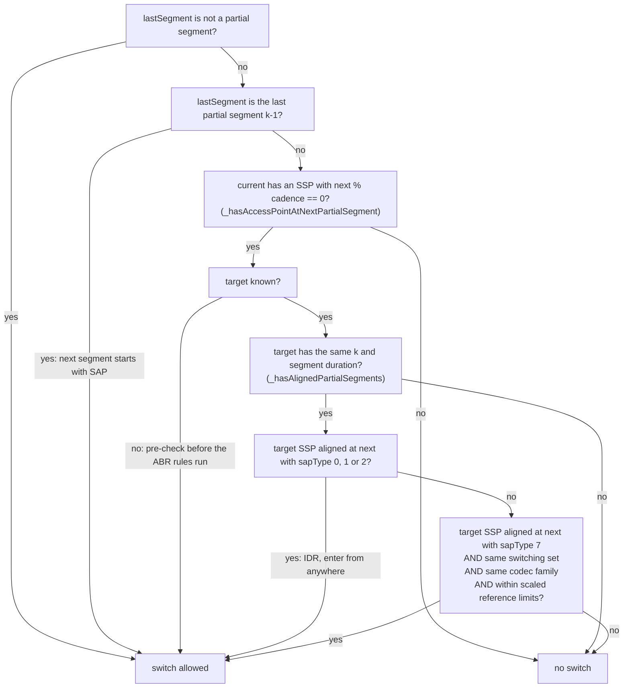

# ABR and S-Frame Switching

This page covers what the ABR logic does differently when content signals switching frames, e.g. AV1 S-Frames, via
`SegmentSequenceProperties` with `sapType="7"`. It assumes you already know the regular dash.js ABR flow (ABR rules →
`AbrController` → `ScheduleController` → `StreamProcessor`/`BufferController`).

There are two use cases, and they follow different logic:

| Use case                                | What decides the switch                                               | Limited by the switch policy (2.7) | Section |
|-----------------------------------------|-----------------------------------------------------------------------|------------------------------------|---------|
| **Startup**: leaving bootstrap          | A fixed transition at the first possible S-Frame. No ABR rules involved. | No                                 | 3       |
| **Rate adaptation** during playback     | The ABR rules, then reachability / hopping, then the switch policy    | Yes                                | 4       |

## 1. Content model

The model has two AdaptationSets that are linked through the adaptation-set-switching supplemental property:

| AdaptationSet       | Purpose                    | `SegmentSequenceProperties`                     | Notes                                                                                          |
|---------------------|----------------------------|-------------------------------------------------|------------------------------------------------------------------------------------------------|
| **Bootstrap**       | Fast tune-in               | `sapType` 0, 1 or 2, `cadence="1"`: IDR at every partial segment | Bitrate is inflated by the IDRs. Only used at startup.                              |
| **Main**            | Regular playback and ABR   | `sapType="7"`, `cadence="N"`: S-Frame at every Nth partial segment | Segments start with a regular SAP (`startWithSAP`). The S-Frames are the mid-segment switch points. |

Each segment is split into `k` partial segments. One segment, from one regular SAP to the next, is called a
**segment sequence** below. A switch can only happen **between partial segments**. The partial segment we switch
*into* has to begin with an access point that the target Representation allows us to enter.

### Example MPD

```xml
<Period>
  <!-- Bootstrap: IDR at every partial segment -->
  <AdaptationSet id="1" contentType="video" mimeType="video/mp4" codecs="av01.0.08M.08"
                 segmentAlignment="true" startWithSAP="1">
    <SupplementalProperty schemeIdUri="urn:mpeg:dash:adaptation-set-switching:2016" value="2"/>
    <SegmentSequenceProperties sapType="1" cadence="1"/>
    <SegmentTemplate timescale="1000" duration="2000" k="8"
                     initialization="bs/$RepresentationID$/init.mp4"
                     media="bs/$RepresentationID$/$Number$_$SubNumber$.m4s"/>
    <Representation id="bs-540" width="960" height="540" bandwidth="2200000"/>
  </AdaptationSet>

  <!-- Main: S-Frame at every partial segment -->
  <AdaptationSet id="2" contentType="video" mimeType="video/mp4" codecs="av01.0.08M.08"
                 segmentAlignment="true" startWithSAP="1">
    <SupplementalProperty schemeIdUri="urn:mpeg:dash:adaptation-set-switching:2016" value="1"/>
    <SegmentSequenceProperties sapType="7" cadence="1"/>
    <SegmentTemplate timescale="1000" duration="2000" k="8"
                     initialization="main/$RepresentationID$/init.mp4"
                     media="main/$RepresentationID$/$Number$_$SubNumber$.m4s"/>
    <Representation id="270p"  width="480"  height="270"  bandwidth="400000"/>
    <Representation id="360p"  width="640"  height="360"  bandwidth="800000"/>
    <Representation id="540p"  width="960"  height="540"  bandwidth="1600000"/>
    <Representation id="720p"  width="1280" height="720"  bandwidth="3000000"/>
    <Representation id="1080p" width="1920" height="1080" bandwidth="6000000"/>
  </AdaptationSet>
</Period>
```

All scenarios below use this ladder with `k = 8` (partial segments `0..7`), unless they say otherwise.

### Relevant settings

| Setting                                                              | Default              | Role                                                                                                        |
|----------------------------------------------------------------------|----------------------|-------------------------------------------------------------------------------------------------------------|
| `streaming.selectionModeForInitialTrack`                             | `lowestStartupDelay` | Picks the bootstrap AdaptationSet at startup.                                                               |
| `streaming.abr.enableSupplementalPropertyAdaptationSetSwitching`     | `true`               | Adds the linked AdaptationSet's Representations to the candidate list. **Required** for leaving bootstrap. |
| `streaming.abr.autoSwitchBitrate.video`                              | `true`               | ABR on/off. Leaving bootstrap ignores this setting.                                                        |
| `streaming.abr.segmentSequenceSwitching.maxUpSwitchesPerSequence`    | `1`                  | Maximum number of up-switches within a segment sequence. `0` means only at the sequence start; `-1` means no limit. |
| `streaming.abr.segmentSequenceSwitching.maxDownSwitchesPerSequence`  | `-1`                 | Maximum number of down-switches within a segment sequence. Each hop counts. `-1` means no limit.          |
| `streaming.abr.segmentSequenceSwitching.allowUpSwitchAfterDownSwitch`| `false`              | When `false`, there is no up-switch after a down-switch in the same sequence.                              |
| `streaming.abr.segmentSequenceSwitching.allowDownSwitchAfterUpSwitch`| `true`               | When `false`, there is no down-switch after an up-switch in the same sequence.                             |
| `streaming.skipInitSegments.video`                                   | `false`              | For self-initializing segments: never request init segments.                                               |

## 2. Building blocks

### 2.1 Can we switch at the next partial segment?

`canPerformQualitySwitch(lastSegment, current, target?)` (`src/streaming/controllers/AbrController.js`) is the
central gate. `next = (lastSegment.replacementSubNumber + 1) % k`.



- **Aligned partial segments** (`_hasAlignedPartialSegments`): after a switch the next request continues with the next
  sub-number of `lastSegment` (template) or at its end time (timeline). This only addresses the boundary validated
  here if the target has the same `k` and segment duration. Otherwise the switch waits for the segment boundary.
  Values that are not signaled are not compared.
- **Same switching set** (`_isInSameSwitchingSet`): the two Representations share an AdaptationSet, or their
  AdaptationSets reference each other through `adaptation-set-switching`.
- **Same codec family** (`_isSameCodecFamily`): linked AdaptationSets may use different codecs, and an S-Frame cannot
  reference frames of another codec. The S-Frame path also neither appends an init segment nor calls `changeType()`.
  The check compares `codecFamily` (e.g. `av01`, `avc`) and is skipped when either side doesn't signal a codec.
- **Scaled reference limits** (`_isWithinScaledReferenceLimits`): this is AV1 spec 7.9. The S-Frame of the
  target references frames of the current Representation. Per dimension:
  - `target * 2 >= current`: you can go down at most 2x.
  - `target <= current * 16`: you can go up at most 16x.
  - The check is skipped when width or height is missing on either side.

### 2.2 Does the switch skip the init segment?

`_entersTargetAtSFrame` decides whether a switch enters at an S-Frame. It is true only when all of these hold:

- `next != 0`, i.e. we are not at a segment boundary
- the target signals an aligned `sapType="7"` at `next`
- the target signals **no** aligned `sapType` 0, 1 or 2 at `next`
- the S-Frame splice conditions from 2.1 are met

`_changeQuality` then sets `noInitSegmentRequired` on `QUALITY_CHANGE_REQUESTED`. It forces the flag to `false`
for `forceReplace` and `forceAbandon`. When the flag is set, the downstream code does three things:

1. `StreamProcessor._handleDifferentSwitchTypes` (`src/streaming/StreamProcessor.js`) marks the target as initialized
   (`setLastInitializedRepresentationId`), so the next request is the target's media partial segment rather than its init
   segment. On an AdaptationSet switch it also skips `setSwitchTrack(true)`.
2. `BufferController._defaultQualitySwitchPreparation` (`src/streaming/controllers/BufferController.js`) only updates
   `timestampOffset`. It does **not** call `abort()` or `changeType()`. An abort would trigger the MSE "reset parser state",
   which sets "need random access point". The non-sync S-Frame samples would then be silently dropped.
3. Fast switching is never used for partial segments (`StreamProcessor.js`, `!lastSegment.isPartialSegment`).

### 2.3 Starting to load without reference frames

A partial segment that starts with an S-Frame only decodes after the preceding partial segment. When the player starts
loading at a time without that predecessor in the decoder, it has to start at a random access point instead.

`StreamProcessor.setExplicitBufferingTime(time, requiresRandomAccessPoint = true)` records whether this is the case.
`_getFragmentRequest` passes the flag via `DashHandler.getSegmentRequestForTime` and `SegmentsController.getSegmentByTime`
to the template and timeline segment getters. When set, `getRandomAccessSubNumber` (`src/dash/utils/SegmentsUtils.js`)
rounds the partial at the requested time down to the last partial that starts with a random access point: one whose SSP
has `sapType` 0, 1 or 2 at a matching cadence, otherwise partial 0. Bootstrap Representations (`sapType="1"`,
`cadence="1"`) are unaffected. For Representations with partial segments but without SSPs only partial 0 is
guaranteed to start with a SAP, so they always restart at partial 0. Full segments are not affected.

| Caller                                              | Random access point required                          |
|-----------------------------------------------------|-------------------------------------------------------|
| Seek outside the buffer, startup                    | yes                                                   |
| Seek inside the buffer (continue at its end)        | no                                                    |
| `forceReplace` (buffer is pruned)                   | yes                                                   |
| Default switch without `segmentAlignment`           | only if there is no continuous buffer at the playhead |
| Retry of an aborted or failed media request         | no                                                    |
| `QuotaExceededError`, pruning ahead of the playhead | no                                                    |

The cost is up to one segment of extra download and decoding before the playhead. A seek or `forceReplace` close to
the end of a segment shows the previous picture until the decoder catches up, at the latest until the next segment.

### 2.4 Hopping

When the ABR target cannot be entered at `next`, `_getReachableRepresentationTowards` doesn't simply wait.
Instead, it picks an intermediate rung:

- **Candidates:** settings-filtered Representations, including linked AdaptationSets but excluding bootstrap ones. Each
  candidate must have a bandwidth in `[min(current, target), max(current, target)]`, must differ from the current
  Representation, and must pass `canPerformQualitySwitch(lastSegment, current, candidate)`.
- **Choice:** the candidate closest to the **target** (`_isCloserInQuality`). The comparison uses bandwidth
  delta first, then pixels/s delta, then the higher `absoluteIndex`.
- **No candidate:** returns `null`, and the switch waits for a later partial segment.

### 2.5 Bootstrap Representations are not ABR candidates

`_filterOutBootstrapRepresentations` runs as part of `getPossibleVoRepresentationsFilteredBySettings`, so every
ABR rule, hop and bootstrap-exit search uses a list without them. The one exception: if **all** candidates are
bootstrap Representations, the list is returned unchanged. This is what makes startup inside the bootstrap AdaptationSet
work.

A Representation counts as bootstrap (`_isBootstrapRepresentation`) only if all of the following hold:

- it has an SSP with `cadence === 1` and a random access SAP type (`SegmentSequenceProperties.isRandomAccessSapType`:
  `sapType` 0, 1 or 2; 0 is the default if none is signaled),
- every Representation of its AdaptationSet is configured that way,
- its AdaptationSet links to another AdaptationSet via `adaptation-set-switching`.

Regular content with a random access point at every partial segment, e.g. a single AdaptationSet, is therefore not
filtered and not left automatically.

`_getPossibleVoRepresentations` lists bootstrap Representations **after** all other Representations and assigns
`absoluteIndex` afterwards. The ABR candidates therefore have an `absoluteIndex` that matches their position in the
filtered list. Rules like BOLA and L2A index their per-Representation arrays by `absoluteIndex`.

The public API (`getRepresentationsByType`, `setRepresentationForTypeById`, `setRepresentationForTypeByIndex`) passes
`includeBootstrapRepresentations = true`, so the Representation that plays during startup is listed. Selecting a
bootstrap Representation manually is possible, but the bootstrap exit leaves it again at the next switch point.

### 2.6 Entry points per scheduling tick

`ScheduleController._scheduleNextRequest` (`src/streaming/controllers/ScheduleController.js`) runs these steps in order:

1. `abrController.handlePendingManualQualitySwitch()`: if it switched, stop here.
2. `abrController.checkPlaybackQuality()`: only when `shouldCheckPlaybackQuality` is set, which happens after a
   media request. It runs:
   1. the bootstrap exit (independent of ABR and of the switch policy)
   2. the wait check: if `lastSegment` still belongs to another Representation (a switch has just happened), no switch
      until a partial segment of the current Representation has been requested. The reference frames of the next
      S-Frame would otherwise come from the Representation before the switch.
   3. the target-agnostic `canPerformQualitySwitch`
   4. the ABR rules
   5. the reachability check and hopping
   6. the switch policy (2.7)
3. If nothing switched, `_getNextFragment()` requests the init segment, or the media segment when the Representation is
   already initialized or `skipInitSegments` is set.

### 2.7 Switch policy within a segment sequence

Partial segments are short, so throughput samples are noisy, and every S-Frame costs more bits than a regular inter
frame. Without limits, the ABR rules can step up through the ladder one partial segment at a time, or flip down and
straight back up. The policy limits **rate-adaptation switches in the middle of a segment sequence** (`next != 0`):

- **Down-switches** are allowed at every reachable partial boundary. Each hop counts as one down-switch
  (`maxDownSwitchesPerSequence`, default unlimited).
- **Up-switches:** at most `maxUpSwitchesPerSequence` (default `1`).
- **Up after down** in the same sequence is blocked (`allowUpSwitchAfterDownSwitch = false`).
- **Down after up** in the same sequence is allowed (`allowDownSwitchAfterUpSwitch = true`). Buffer safety comes first.

How it works:

- **When it's checked:** `_isAllowedBySegmentSequenceSwitchingSettings` runs on the Representation that would
  actually be switched to (the hop, if any), after the reachability check. If it is blocked, the current Representation
  keeps loading.
- **How a switch is classified:** by `@bandwidth`, higher = up. A switch to a Representation with the same bandwidth is
  neither counted nor limited.
- **Counting:** `_addSegmentSequenceSwitch` counts switches per stream and media type, keyed by the start time of
  the segment `lastSegment` belongs to (`_getSegmentSequenceKey`). The segment index is not stable in a sliding
  SegmentTimeline: once an MPD update removes old `S` elements, consecutive segments can have the same index. The
  index is only used if the start time is unknown. The counters reset as soon as the segment changes, including
  after a seek.
- **Not affected:** switches at the start of a segment sequence (`next == 0`, regular SAP with init segment), the
  bootstrap exit, manual quality switches and abandonment. These are neither limited nor counted.

---

## 3. Use case: startup

### S1: Startup in bootstrap, exit through an S-Frame (happy path)

1. **Track selection.** `lowestStartupDelay` (`MediaController.js`) keeps the AdaptationSets whose SSPs contain a
   bootstrap configuration (`_getL3DBootstrapTracks`, `MediaController.js`). That selects AS 1.
2. **Initial Representation.** `StreamProcessor` calls `getOptimalRepresentationForBitrate(bootstrapMediaInfo, initialBitrate, false)`
   (`StreamProcessor.js`). Because `includeCompatibleMediaInfos = false`, only bootstrap Representations are
   candidates and the bootstrap filter leaves them untouched. Result: `bs-540`.
3. **First requests.** The player requests the `bs-540` init segment, then partial segment `n` (`n = 0` for VoD start). It
   decodes immediately because every bootstrap partial starts with an IDR.
4. **Bootstrap exit.** On the next tick, `checkPlaybackQuality` calls `_getBootstrapExitRepresentation`:
   - The candidates are the non-bootstrap Representations of AS 2, via `adaptation-set-switching`, that pass
     `canPerformQualitySwitch` at `next = n+1`.
   - With `cadence="1"`, every main Representation has an aligned S-Frame. All five are in the same switching set. All are
     within the scaling limits relative to 540p: 270p is exactly 2x down, and 1080p is 2x up.
   - The function picks the candidate **closest in resolution to the bootstrap Representation**, and the lowest
     `@bandwidth` among several with that resolution (`_isBetterBootstrapExit`). That is `540p`. The bootstrap
     `@bandwidth` is not used, because the IDRs inflate it: closest in bandwidth could be a rung above the bootstrap
     quality. Without signaled `@width`/`@height`, the closest `@bandwidth` is used instead.
   - This step ignores `autoSwitchBitrate`, the ABR rules and the switch policy, and it is not counted as an up-switch.
5. **The switch.** `_changeQuality(bs-540 → 540p)`:
   - `isAdaptationSetSwitch = true`.
   - `noInitSegmentRequired = true`, because `next ≠ 0` and the target has an aligned SAP 7 and no SAP 0, 1 or 2 at `next`.
   - Downstream, no `setSwitchTrack`, no init segment, no `abort()`/`changeType()`. Only `timestampOffset` is updated.
   - The next request is `540p` partial `n+1`, which begins with an S-Frame that references the `bs-540` frames already
     in the decoder.
6. **From here on**, rate adaptation applies (Section 4). The sequence the exit happened in still has its full up-switch
   budget.

**Result:** startup costs one bootstrap partial segment, followed by a seamless switch into the main ladder without
re-initializing the decoder.

### S2: Main S-Frame cadence > 1

Same as S1, but AS 2 uses `cadence="4"`, so S-Frames sit at partials 0, 4 and later multiples of 4 (0 is the regular SAP).

- After partials 0 to 2 of `bs-540`, no main Representation has an aligned access point at `next`, so the exit returns
  `null`.
- `checkPlaybackQuality` continues. The target-agnostic gate passes because bootstrap has `cadence="1"`, and the ABR
  rules may propose a main rung. `_getReachableRepresentationTowards` finds nothing reachable (no aligned S-Frame) and
  returns `false`. The next bootstrap partial is requested.
- After partial 3, `next = 4` is aligned, and the exit happens as in S1 with `noInitSegmentRequired = true`.

**Result:** the player stays on bootstrap for up to `cadence` partial segments. All of them are paid at the inflated
bootstrap bitrate.

### S3: Bootstrap exit at a segment boundary

When the last bootstrap partial is `k-1` (for example, startup happened late in a segment, or the exit was delayed as in
S2), `canPerformQualitySwitch` returns `true` for any target (rule 2 in 2.1). `_entersTargetAtSFrame` returns `false`
because `next = 0`. That gives a regular AdaptationSet switch:

- `setSwitchTrack(true)` is called, the main init segment is loaded, and `abort()` and `changeType()` run.
- The main segment starts with its regular SAP (`startWithSAP`).

### S4: Bootstrap exit with ABR disabled

When `autoSwitchBitrate.video = false`, the bootstrap exit **still** happens, because it runs before the ABR gate. After
the exit, ABR stays off and the player remains on the rung with the bootstrap resolution chosen in S1, step 4.

### S5: Not a partial-segment stream / `k` missing

When `lastSegment.isPartialSegment` is false, `canPerformQualitySwitch` always returns `true` and
`_entersTargetAtSFrame` returns `false`. The bootstrap exit happens right after the first segment, as a regular switch
with an init segment. Bootstrap provides no benefit in this case.

### S6: Startup with `skipInitSegments.video = true`

The ABR decisions match S1 to S3. The only difference is in `ScheduleController._getNextFragment`: no init
segment is ever requested, neither at startup nor after the S3-style boundary switch. Every media segment has to carry
its own `moov`. SourceBuffer preparation is **not** affected: a non-S-Frame switch still runs `abort()` and `changeType()`.

---

## 4. Use case: rate adaptation during playback

All of these start on a main Representation. Assume the last downloaded partial is `3`, so `next = 4`, `cadence="1"`,
default policy settings, and the switch is not at a segment boundary, unless stated otherwise.

### M1: Up-switch within the main AdaptationSet

The ABR rules choose `360p → 1080p`.

- Gate: `current` has an aligned SSP.
- Target: SAP 7 aligned, same AdaptationSet, and `1080 ≤ 360 × 16`. The target is reachable.
- Policy: this is the first up-switch in the sequence, so it's allowed.
- `noInitSegmentRequired = true`, and the next request is `1080p` partial 4.

Any up-switch within the ladder works in one step, because the 16x upscale limit is never reached in practice.

### M2: Down-switch within the 2x limit

The ABR rules choose `1080p → 540p`. `540 × 2 ≥ 1080`, so this is allowed. It behaves like M1. The policy doesn't limit
down-switches by default.

### M3: Down-switch beyond 2x → hop

The ABR rules choose `1080p → 360p`. `360 × 2 = 720 < 1080`, so the target is **not** reachable at `next`.

`_getReachableRepresentationTowards` looks at candidates with bandwidth in `[0.8, 6.0]` Mbps that are reachable from 1080p:

| Rung | 2x check            | Reachable | Bandwidth Δ to target (0.8 Mbps) |
|------|---------------------|-----------|----------------------------------|
| 720p | `720 × 2 ≥ 1080` ✔ | ✔         | 2.2                              |
| 540p | `540 × 2 ≥ 1080` ✔ | ✔         | **0.8** ← chosen                 |
| 360p | ✘                   | ✘         | –                                |

The player switches to `540p` at partial 4 through an S-Frame (`noInitSegmentRequired = true`). On the next tick, the
ABR rules run **again**, starting from 540p. If they still want 360p, `540 → 360` is within 2x and completes at partial 5.
Both hops count as down-switches.

- If throughput has recovered in the meantime, the player stays on 540p for the rest of the sequence. Going back up is
  blocked by `allowUpSwitchAfterDownSwitch = false`.
- With `maxDownSwitchesPerSequence = 1`, the second hop is blocked and the player finishes the sequence on 540p.

`1080p → 270p` works the same way: it hops to `540p` (exactly 2x), then reaches `270p`.

### M4: Several up-switches in one sequence (the "multiple switches up" problem)

Throughput keeps rising and the ABR rules request one rung higher at every partial: `360p → 540p` after partial 2,
`540p → 720p` after partial 3, and `720p → 1080p` after partial 4.

| Settings                              | Result in this sequence                                                    |
|---------------------------------------|----------------------------------------------------------------------------|
| Default (`maxUpSwitchesPerSequence=1`)| `360p → 540p` at partial 3. The next two requests are blocked. `540p → …` happens at the next sequence. |
| `maxUpSwitchesPerSequence = 0`        | No mid-sequence up-switch. Up-switches only happen at the segment boundary (M5). |
| `maxUpSwitchesPerSequence = -1`       | Old behavior: three S-Frame switches in a row.                              |

The policy doesn't make ABR pick a bigger jump. If the rules propose `360p → 1080p` directly, that single up-switch
happens (M1).

### M5: Switch at the segment boundary

The last partial is `7`, so `next = 0`. The gate returns `true` for any target. `noInitSegmentRequired = false`, so this is
a regular switch: init segment, `abort()`, `changeType()`. The target starts with its regular SAP. The scaling limits
and the switch policy do **not** apply here, so even `1080p → 270p` happens in one step. The counters for the new
sequence start at zero.

### M6: Partial segment not aligned with the cadence

With `cadence="4"` and `next = 5`, the target-agnostic gate already fails because `current` has no aligned SSP. The ABR
rules are not run. The next partial of the current Representation is requested, and the switch is re-evaluated after
partials 7 (boundary) and 3 (next = 4).

### M7: Switching sets and linked AdaptationSets

Candidates only come from the current AdaptationSet and the ones it lists in `adaptation-set-switching`
(`_getPossibleMediaInfos`). An AdaptationSet that is not linked therefore never becomes an ABR target, so the
"not in the same switching set" branch of the S-Frame check is mostly defensive.

The opposite case matters more. Every linked AdaptationSet counts as the same switching set, even one with a
different codec. Say an AVC AdaptationSet is linked to the AV1 main set. A switch from an AVC Representation into an
AV1 S-Frame passes `_isInSameSwitchingSet` but fails `_isSameCodecFamily`, so the player waits for the next segment
boundary and switches with an init segment and `changeType()`.

### M8: Target signals both an IDR and an S-Frame at `next`

If the target has an aligned SSP with `sapType` 0, 1 or 2 at `next`, the gate passes no matter which switching set or scaling
limits apply. `_entersTargetAtSFrame` returns `false`, so the init segment is loaded and the decoder is reset. The IDR
wins over the S-Frame. Because `next != 0`, the switch policy still applies.

### M9: Manual switch (`setRepresentationForTypeByIndex`)

`manuallySetPlaybackQuality`:

1. A newer manual request replaces a queued one.
2. With `forceReplace`, the switch happens immediately, without the switch point check or hops. The replacement prunes
   the buffer and restarts loading at a random access point of the target (2.3), it never enters at an S-Frame.
3. If `lastSegment` still belongs to another Representation (a switch has just happened and no partial segment of the
   current Representation has been requested yet), the request is queued. The reference frames of the next partial
   segment still come from the previous Representation.
4. If `canPerformQualitySwitch(lastSegment, current, target)` passes, the switch happens immediately (like M1 and M2).
5. Otherwise the request is **queued**. On every tick, `handlePendingManualQualitySwitch` runs
   `_getReachableRepresentationTowards`:
   - If it returns the target, the switch happens and the queue entry is removed. If the target is already the
     current Representation, it returns `false`, so the ScheduleController continues with the next request.
   - If it returns an intermediate rung, the player hops and the request **stays queued**.
   - If it returns `null`, nothing happens this tick.

**Example:** `1080p → 270p` requested at partial 3 means partial 4 = `540p` (hop, still queued) and partial 5 = `270p`
(dequeued). A manual request always reaches its target, because the queue persists. Unlike M3, it doesn't depend on the
ABR rules re-deciding. Manual switches are **exempt** from the switch policy and don't count against the ABR's budget.

### M10: Abandonment

`_canAbandonRequest` only allows abandoning partial **0**, because only that one is guaranteed to start with
an IDR. An abandon switch carries `forceAbandon`, so `noInitSegmentRequired = false`: init segment and full decoder
reset. While the abandonment state is not `ALLOW_LOAD`, `checkPlaybackQuality` only accepts down-switches. Abandonment
switches are not counted by the policy.

### M11: Audio

Audio Representations have no width or height, so the scaling check is skipped. Audio doesn't usually signal SAP 7.
Without SSPs, `_hasAccessPointAtNextPartialSegment` returns `false` mid-segment, so audio only switches at segment
boundaries, and the policy never applies to it.

---

## 5. Edge cases and limits

| Case                                                              | Behavior                                                                                                    |
|-------------------------------------------------------------------|--------------------------------------------------------------------------------------------------------------|
| `width`/`height` missing on either Representation                 | The scaling check passes (permissive). An S-Frame splice may be attempted that the decoder cannot handle.   |
| Only bootstrap Representations available (no linked AS)          | The bootstrap filter is a no-op, the bootstrap exit returns `null`, and the player plays bootstrap for the whole session. |
| `enableSupplementalPropertyAdaptationSetSwitching = false`        | Same as above. The main AS never shows up as a candidate, but `_isInSameSwitchingSet` would still accept it. |
| No reachable rung toward the target                               | `checkPlaybackQuality` returns `false`, and the player stays on the current Representation for this partial. |
| Switch blocked by the policy                                      | `checkPlaybackQuality` returns `false`, the current Representation keeps loading, and the decision is re-evaluated at the next partial. |
| Two Representations with the same `@bandwidth`                    | Treated as neither up nor down: not limited and not counted.                                                |
| Portal size / max bitrate / CMSD filters                          | These also apply to the bootstrap exit and to hop candidates. A filtered-out rung cannot serve as a hop.    |
| Current Representation has no SSP (mid-segment)                   | No switch until the segment boundary.                                                                       |
| `forceReplace` / `forceAbandon`                                   | `noInitSegmentRequired = false`. The S-Frame path is never used. `forceReplace` reloads from the last random access point before the playhead (2.3). |
| Seek outside the buffer                                           | Loading starts at the last random access point before the seek target (2.3).                                |
| Current Representation excluded (`excludeRepresentation`)          | `_switchAwayFromExcludedRepresentation`: switch to the fallback if it is reachable, otherwise hop towards it and queue it like a manual switch. If not even a hop is possible, `forceReplace` to the fallback. |

## 6. Known limitations and open questions

1. **Getting stuck in bootstrap when adaptation-set switching is disabled.** With
   `enableSupplementalPropertyAdaptationSetSwitching = false`, there is no exit and no warning.
2. **Hops in auto ABR are not remembered.** In M3, the player only reaches the original target if the rules decide
   the same way again on the next tick. The manual path (M9) keeps the target queued.
3. **The scaling check uses the MPD's `@width`/`@height`.** AV1 superres or a render size that differs from the coded
   frame size is not accounted for. Missing dimensions are treated as "allowed".
4. **The gate checks cadence on the current Representation** (`_hasAccessPointAtNextPartialSegment`). This assumes the
   cadence is uniform across the switching set.
5. **`skipInitSegments` is per media type, not per Representation/AdaptationSet.**
6. **The policy is counted, not timed.** It limits switches per segment sequence. A switch at partial 7 and one at
   partial 1 of the next sequence are still only two partials apart. If that turns out to be a problem, a minimum
   number of partials between switches would be the next option.
7. **The ABR rules don't know about the policy.** A blocked request is dropped and re-proposed on the next partial.
   `checkPlaybackQuality` adds the requested target to the switch request history **before** the reachability and
   policy checks, so `SwitchHistoryRule` sees blocked requests as switches. This was already the case for unreachable
   targets. It may be worth recording only applied switches.
8. **No functional test coverage yet.** Unit tests in `test/unit/test/streaming/streaming.controllers.AbrController.js`
   cover bootstrap exit, S-Frame switching, scaling limits, hopping and the switch policy. The end-to-end path (MSE
   append without abort, no init segment) has only been checked manually.
9. **`forceReplace` freezes the picture.** `forceReplace` prunes the whole buffer and reloads from the last random
   access point before the playhead (2.3), which is usually the start of the segment. The decoder has to decode all
   frames up to the playhead first. With 8 s segments and AV1 720p in Chrome, the picture froze for 1.5 to 4 s, at
   times with a short stall. Re-entering through a bootstrap Representation, which has an IDR at every partial segment,
   would shorten this, but only works if a bootstrap AdaptationSet exists.
10. **Absolute indices when only bootstrap Representations remain.** If settings or exclusions remove every main
    Representation, `_filterOutBootstrapRepresentations` falls back to the bootstrap Representations. Their
    `absoluteIndex` was assigned after the main ladder, so it doesn't match their position in the filtered list. BOLA
    and L2A index their arrays by `absoluteIndex` and pick wrong or no Representations. This is the same limitation
    that dash.js already has when a settings filter removes the lowest Representations (see
    `setRepresentationForTypeByIndex` in `src/streaming/mediaplayer/TrackApi.js`). A fix would make these rules
    independent of `absoluteIndex`.

## 7. Code reference index

All functions without a file are in `src/streaming/controllers/AbrController.js`.

| Concern                         | Location                                                                                       |
|---------------------------------|------------------------------------------------------------------------------------------------|
| Constants (SAP 7, 2x / 16x)     | `S_FRAME_SAP_TYPE`, `S_FRAME_MAX_DOWNSCALE_FACTOR`, `S_FRAME_MAX_UPSCALE_FACTOR`                |
| Bootstrap filter and order      | `_isBootstrapRepresentation`, `_filterOutBootstrapRepresentations`, `_moveBootstrapRepresentationsToTheEnd` |
| ABR entry point                 | `checkPlaybackQuality`                                                                         |
| Switch policy                   | `_isMidSegmentSequenceSwitch`, `_getSegmentSequenceKey`, `_getSegmentSequenceSwitchState`, `_isAllowedBySegmentSequenceSwitchingSettings`, `_addSegmentSequenceSwitch` |
| Switch gate                     | `canPerformQualitySwitch`, `_hasAlignedPartialSegments`                                        |
| Cadence check (current)         | `_hasAccessPointAtNextPartialSegment`                                                          |
| SAP check (target)              | `_targetAllowsSwitchInAtNextPartialSegment`                                                    |
| S-Frame splice conditions       | `_canSpliceIntoSFrame`, `_isWithinScaledReferenceLimits`, `_isInSameSwitchingSet`, `_isSameCodecFamily` |
| Skip init on S-Frame            | `_entersTargetAtSFrame`, used in `_changeQuality`                                              |
| Hopping                         | `_getReachableRepresentationTowards`                                                           |
| Bootstrap exit                  | `_getBootstrapExitRepresentation`, `_isBetterBootstrapExit`                                    |
| Closest-quality comparator      | `_isCloserInQuality`                                                                           |
| Manual switch / queue           | `manuallySetPlaybackQuality`, `handlePendingManualQualitySwitch`                               |
| Excluded current Representation | `_switchAwayFromExcludedRepresentation`                                                        |
| Abandon restriction             | `_canAbandonRequest`                                                                           |
| Policy settings                 | `src/core/Settings.js` (`SegmentSequenceSwitchingSettings`), `index.d.ts`                     |
| Bootstrap classification        | `src/dash/vo/SegmentSequenceProperties.js` (`isBootstrapConfiguration`, `isRandomAccessSapType`) |
| Random access after seek/replace | `src/dash/utils/SegmentsUtils.js` (`getRandomAccessSubNumber`), `src/streaming/StreamProcessor.js` (`setExplicitBufferingTime`) |
| Initial track selection         | `src/streaming/controllers/MediaController.js` (`_getL3DBootstrapTracks`, `lowestStartupDelay`)|
| Initial Representation          | `src/streaming/StreamProcessor.js` (`getOptimalRepresentationForBitrate` call)                 |
| Switch handling without init    | `src/streaming/StreamProcessor.js` (`_handleDifferentSwitchTypes`)                             |
| SourceBuffer prep without abort | `src/streaming/controllers/BufferController.js` (`_defaultQualitySwitchPreparation`)           |
| Scheduling order                | `src/streaming/controllers/ScheduleController.js` (`_scheduleNextRequest`, `_getNextFragment`) |
